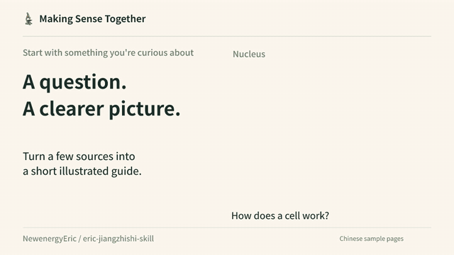

# Making Sense Together
**一起读懂** · [中文](README.md)

Two independent AI skills for turning a question and a few sources into a clear, illustrated guide. Use them for science explainers, class handouts or a two-page booklet.

[Download the skills](https://github.com/NewenergyEric/eric-jiangzhishi-skill/releases/latest) · [See the examples](#two-complete-examples) · [Get started](docs/getting-started.en.md)

[](media/intro/intro.en.mp4)

A 16-second looping preview, about 415 KB, without narration. Click the animation to open the MP4. All videos are 365–543 KB. Each format keeps the complete story, with its own text and illustration layout.

| Format | English | 中文 |
|---|---|---|
| Landscape 16:9 · 960 × 540 | [MP4 · 430 KB](media/intro/intro.en.mp4) · [GIF](media/intro/intro.en.gif) | [MP4 · 403 KB](media/intro/intro.mp4) · [GIF](media/intro/intro.gif) |
| Square 1:1 · 720 × 720 | [MP4 · 406 KB](media/intro/square/intro.en.mp4) · [GIF](media/intro/square/intro.en.gif) | [MP4 · 365 KB](media/intro/square/intro.mp4) · [GIF](media/intro/square/intro.gif) |
| Portrait 9:16 · 720 × 1280 | [MP4 · 543 KB](media/intro/vertical/intro.en.mp4) · [GIF](media/intro/vertical/intro.en.gif) | [MP4 · 519 KB](media/intro/vertical/intro.mp4) · [GIF](media/intro/vertical/intro.gif) |

[Storyboard, posters and source](media/intro/README.en.md).

## Two skills. Start with what you have.

| What you have | Which skill to use |
|---|---|
| Sources and an idea that still need explaining | [Content & explanation](skills/knowledge-to-friendly-product/README.en.md): check the sources, shape the explanation and carry it through to a finished guide |
| Approved copy that needs illustration and layout | [Illustration & layout](skills/knowledge-card-art-direction/README.en.md): keep the content, make the artwork, lay out the pages and proof the export |

The first skill can handle a small project from start to finish. The second can pick up where your writing is already done. Install either or both. Their stable folder names are `knowledge-to-friendly-product` and `knowledge-card-art-direction`.

Bring a topic, an audience and your sources. Keep the finished guide, editable copy, chosen images, generation prompts and layout source. New illustrations require an image-generation tool; reading the skill instructions requires no Python setup.

## Try a small topic

1. Download the archive with `skills` in its filename from [Releases](https://github.com/NewenergyEric/eric-jiangzhishi-skill/releases/latest).
2. Ask an AI assistant with file access to read the chosen folder's `SKILL.md`. For regular use, copy the whole folder into your tool's supported skills directory.
3. Give it the sources, intended reader and output you want. For example:

> Read knowledge-to-friendly-product. Use my attached sources to make a two-page introduction to cells for a reader with no biology background. First explain how the parts of a cell work together, then compare animal, plant and bacterial cells. Write in English. Use warm paper and hand-drawn illustrations, with playful titles and clear body text. Deliver the PDF, editable copy, artwork and sources.

The full package also includes a copy helper: `python scripts/install_skill.py knowledge-to-friendly-product --dest ./my-skills`. It stops if that destination already contains the skill.

[Detailed steps](docs/getting-started.en.md) · [HTML start page](docs/getting-started.en.html) · [Installation checklist](docs/installation-checklist.en.md)

## Two complete examples

| Topic | What the two pages explain | Read and explore |
|---|---|---|
| The eight planets | Start on Earth, visit the four rocky planets, then the four outer giants | [English reading version](examples/solar-system/read.en.html) · [Original Chinese PDF](examples/solar-system/output/solar-system.pdf) · [Production notes in Chinese](examples/solar-system/process.md) |
| Getting to know cells | Look inside a typical animal cell, then compare a leaf cell and a bacterium | [English reading version](examples/cells/read.en.html) · [Original Chinese PDF](examples/cells/output/cells.pdf) · [Production notes in Chinese](examples/cells/process.md) |

Each example is two pages with no extra cover. An image model made the illustrations, handwritten titles and icons; body copy and precise labels are typeset separately. The English reading pages translate the complete text. The existing PDFs and text inside their artwork remain in Chinese, as shown in the video.

## Make it your own

Edit `content.json` or `content.en.json` in an example folder. Chosen artwork is in `art/`; full image prompts are in `prompts.json`. The full release includes these files, the open font and build scripts.

```sh
python -m pip install -r requirements.txt
python scripts/build_example.py --case cells
python scripts/build_html.py
python scripts/verify_project.py
```

The PDF command rebuilds the Chinese illustrated edition. The HTML command rebuilds both reading languages. Handwritten titles are image assets; changing them means generating a new image or using typeset text.

[Rebuild the videos](media/intro/README.en.md) · [What was checked](docs/verification.en.md) · [Publication file list](publish-files.json)

Methods, code and the original material this project can license use [MIT](LICENSE). The font uses the OFL. AI-generated images do not imply exclusive copyright. See [licenses and sources](THIRD_PARTY_NOTICES.en.md).
