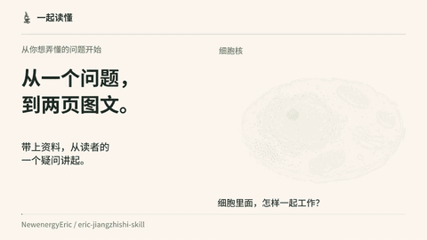

# 一起读懂
**Making Sense Together** · [English](README.en.md)

两套可以单独使用的 AI Skill，陪你把一个好奇的问题，做成容易读懂的知识图文。适合科普文章、课堂讲义和两页小册子。

[下载 Skill](https://github.com/NewenergyEric/eric-jiangzhishi-skill/releases/latest) · [看案例](#两份完整案例) · [使用说明](docs/getting-started.md)

[](media/intro/intro.mp4)

16 秒，无旁白。[中文 MP4](media/intro/intro.mp4) · [English MP4](media/intro/intro.en.mp4) · [静态预览](media/intro/poster.png) · [分镜与源码](media/intro/README.md)。每个 MP4 约 2 MB，GIF 小于 3 MB。

## 两个 Skill，按手上的内容来选

| 你手上有什么 | 从哪个 Skill 开始 |
|---|---|
| 资料和想法，还没想好怎么讲 | [内容梳理](skills/knowledge-to-friendly-product/SKILL.md)：核对资料、组织解释，继续完成图文 |
| 已经定稿的文字，想改善画面 | [插画排版](skills/knowledge-card-art-direction/SKILL.md)：沿用定稿，完成插画、文字排版、校样和导出 |

第一个也能完成整个小项目；第二个适合直接接手已有内容。它们可以配合，也可以各自安装。目录名仍是 `knowledge-to-friendly-product` 和 `knowledge-card-art-direction`，已有安装方式继续可用。

你提供主题、读者和资料，成稿保留来源；正文、采用图片、生成提示和排版源也一起留下，方便下一次修改。制作新插画需要图像生成工具；读取方法文档不需要 Python。

## 从一个小问题开始

1. 在 [Release](https://github.com/NewenergyEric/eric-jiangzhishi-skill/releases/latest) 下载文件名含 `skills` 的小包并解压。
2. 让支持读取文件的 AI 助手打开所选目录的 `SKILL.md`。长期使用时，把整个目录复制到工具支持的技能目录。
3. 带上资料，交代读者和想做的成品。例如：

> 读取 knowledge-to-friendly-product。用我附的资料，给没有生物学背景的读者做两页细胞介绍。先讲细胞内部怎样工作，再比较动物、植物和细菌。用暖纸手绘风格，标题可以手写，正文要清楚好读。交付 PDF、可编辑文字、插画和来源。

需要辅助复制时，可在完整包中运行 `python scripts/install_skill.py knowledge-to-friendly-product --dest ./my-skills`。目标已有同名目录时，脚本会停止。

[详细步骤](docs/getting-started.md) · [HTML 上手入口](docs/getting-started.html) · [安装检查清单](docs/installation-checklist.md)

## 两份完整案例

| 主题 | 这两页讲什么 | 成稿与过程 |
|---|---|---|
| 太阳系八大行星 | 从地球出发，认识内侧四颗行星和外侧四颗巨行星 | [中文 PDF](examples/solar-system/output/solar-system.pdf) · [中文阅读版](examples/solar-system/read.html) · [English text](examples/solar-system/read.en.html) · [制作过程](examples/solar-system/process.md) |
| 认识细胞 | 看典型动物细胞的内部，再比较叶片细胞和细菌 | [中文 PDF](examples/cells/output/cells.pdf) · [中文阅读版](examples/cells/read.html) · [English text](examples/cells/read.en.html) · [制作过程](examples/cells/process.md) |

每例都是两页，没有额外封面。插画、手写标题和图标由图像模型生成，正文与结构标签单独排版。手写标题是图片素材，改字需要重新生成或换成排版字体。英文阅读版翻译了完整正文；现有 PDF 与插画内的文字保留中文。

## 自己修改案例

文字在各例的 `content.json` 与 `content.en.json`，采用图片在 `art/`，完整生图提示在 `prompts.json`。完整发布包包含这些源文件、开放字体和构建脚本。

```sh
python -m pip install -r requirements.txt
python scripts/build_example.py --case cells
python scripts/build_html.py
python scripts/verify_project.py
```

[视频重建](media/intro/README.md) · [实际检查范围](docs/verification.md) · [公开文件清单](docs/publish-allowlist.md)

方法、代码与本项目可授权的原创内容采用 [MIT](LICENSE)；字体遵循 OFL。AI 生成图像不代表排他版权，第三方来源与依赖见 [许可说明](THIRD_PARTY_NOTICES.md)。
