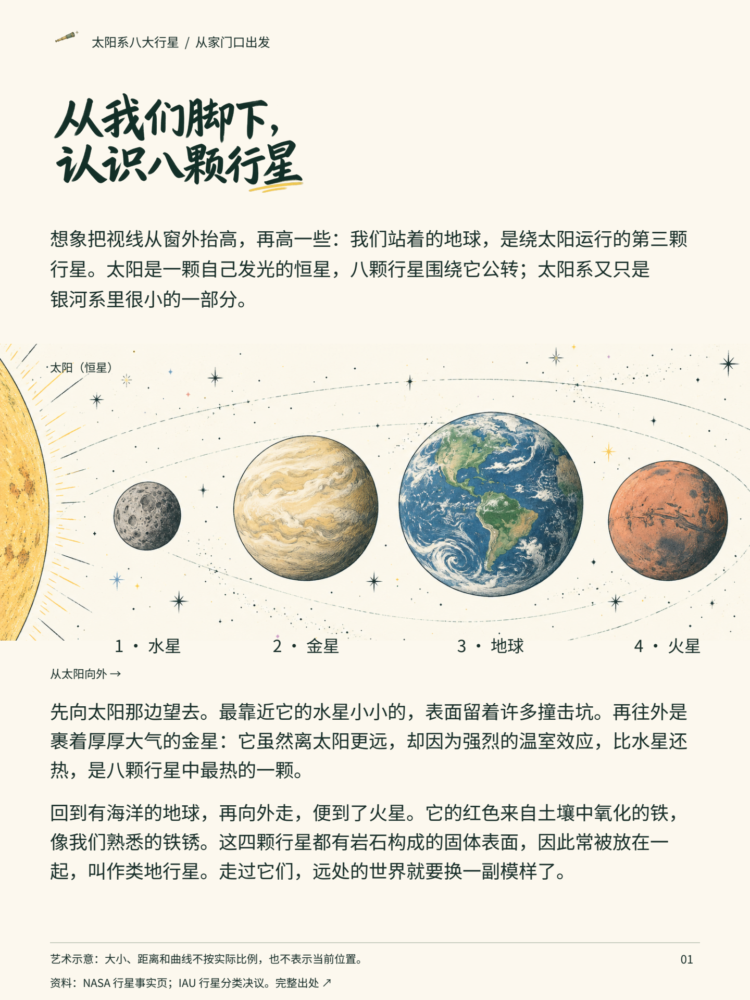
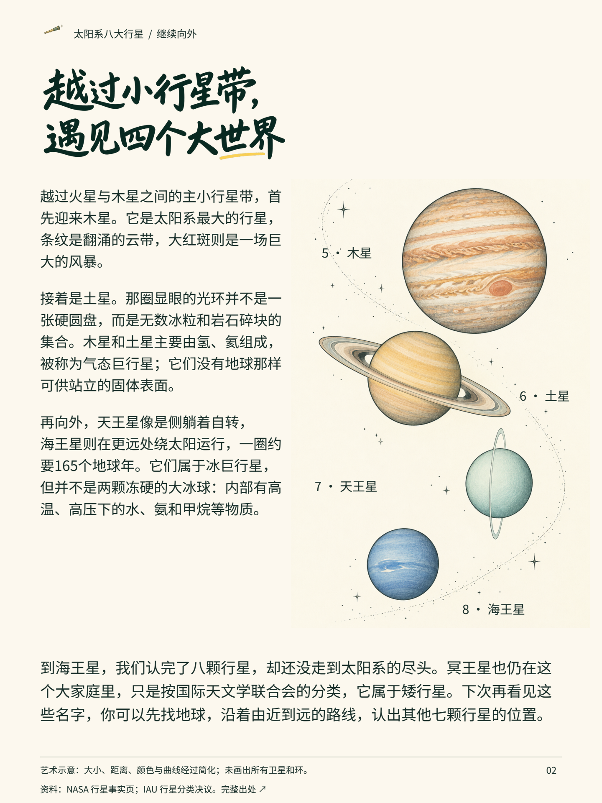
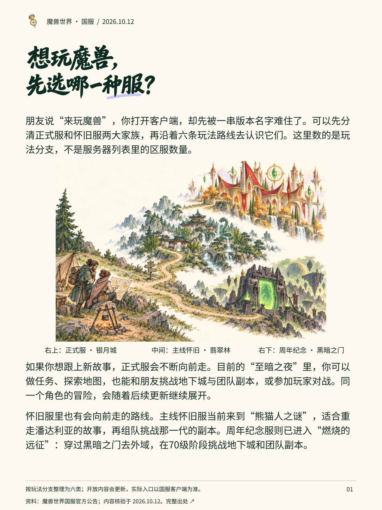
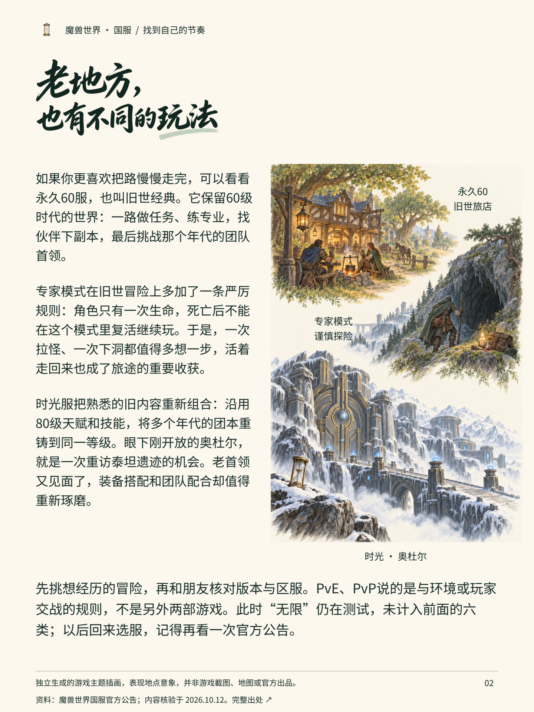

# 把知识讲给人听

有了资料，离一份让人愿意读的图文，还差几步：把原理弄明白，想清楚读者为什么在意，再决定哪句话该讲、哪一段值得画。

这套 Skill 帮你把这些步骤接起来。适合需要把专业资料写成通俗图解的老师、作者、内容编辑，也适合想和 AI 一起做一份知识小册子的人。它保留来源与边界，不把正文压成几条口号。

**[下载当前版本](https://github.com/NewenergyEric/eric-jiangzhishi-skill/releases/latest)** · [中文上手说明](docs/getting-started.md) · [HTML 上手入口](docs/getting-started.html) · [安装检查清单](docs/installation-checklist.md)

## 先看看做出来是什么样

两个新案例，各两页，没有额外封面。插画和手写标题实际由图像模型生成，准确正文与标签独立排版。下面的图片可以点开看大图。

### 太阳系八大行星

从脚下的地球出发，先认识内侧四颗类地行星，再向外看四颗巨行星。用一段旅程讲清顺序、特征与分类。

[PDF](examples/solar-system/output/solar-system.pdf) · [文字阅读版](examples/solar-system/read.html) · [制作过程](examples/solar-system/process.md) · [来源](examples/solar-system/sources.md)

[](examples/solar-system/output/page-01.png)
[](examples/solar-system/output/page-02.png)

### 魔兽世界：先选一种冒险

面向刚开始了解游戏的人，把国服的版本分支与玩法节奏讲清楚。按2026年10月12日的官方资料整理六条玩法路线，区别于区服总数；测试中的内容另行说明。

[PDF](examples/warcraft/output/warcraft.pdf) · [文字阅读版](examples/warcraft/read.html) · [制作过程](examples/warcraft/process.md) · [来源和时效范围](examples/warcraft/sources.md)

[](examples/warcraft/output/page-01.png)
[](examples/warcraft/output/page-02.png)

## 两个 Skill，各负责什么

| Skill | 适合什么时候用 | 做什么 |
|---|---|---|
| [把知识讲给人听](skills/knowledge-to-friendly-product/SKILL.md) | 资料刚到手，要从头做内容 | 理解知识、拆解关系、找到读者情境、自然表达、统一美术和可信介绍 |
| [知识卡包美术与排版](skills/knowledge-card-art-direction/SKILL.md) | 内容已定，要制版或改善阅读 | 插画任务、布局变化、中文适配、内容锁定、排版检查与导出 |

可以一起用，也能单独复制一个完整目录。每个 Skill 自带参考、模板或脚本，不依赖之前的项目与私人路径。

## 最短使用方式

下载并解压发布包，让能读取文件的 AI 助手读取所需的 `SKILL.md`，然后说：

> 读取这个 Skill。主题是【主题】，读者是【已有知识和阅读情境】，资料是【文件或链接】。请做成【载体和页数】，沿用【风格或参考】。先核实知识，再写成自然连贯的图文，交付成品、源文件与实际检查记录。

若宿主已识别该 Skill，也可用 `$knowledge-to-friendly-product` 调用。复制目录成功不代表宿主已自动加载，具体技能目录按所用工具确定。

需要辅助复制时，可运行：

```sh
python scripts/install_skill.py knowledge-to-friendly-product --dest ./my-skills
```

它只复制到明确指定的位置；同名目标已存在时停止，不自动覆盖。读取方法文档无需 Python；复制脚本和两个检查脚本只需 Python 3 标准库。

## 修改和复现案例

文字在每个案例的 `content.json`，图片及标题字图在 `art/`，完整提示在 `prompts.json`，共同排版源在 [scripts/build_example.py](scripts/build_example.py)。标题字图是 PNG，不是完整可安装字库；改标题时需要重新生成并校对，或改回排版字体。

```sh
python -m pip install -r requirements.txt
python scripts/build_example.py --case solar-system
python scripts/build_example.py --case warcraft
python scripts/verify_project.py
```

构建使用包内图片和开放字体，不调用图像 API。重新生图需要你自己的可用图像工具。固定 PDF 以桌面或放大阅读为主；手机可打开同内容的文字阅读版。

## 验证与许可

公开版检查了文件引用、辅助脚本、两份 PDF 与四张成稿、独立解压和安装复制，并对发布白名单及提交树做脱敏检查。覆盖范围与限制见 [验证记录](docs/verification.md)。没有把模型自检说成真实读者试读，也没有测试所有宿主的自动加载。

方法、代码与原创内容使用 [MIT](LICENSE)。字体保留 OFL；游戏商标、设定和第三方资料不在本项目可授予的权利内，见 [素材与许可说明](THIRD_PARTY_NOTICES.md)。案例没有使用官方游戏图片，也没有附参考书、旧商品内容或个人资料。
