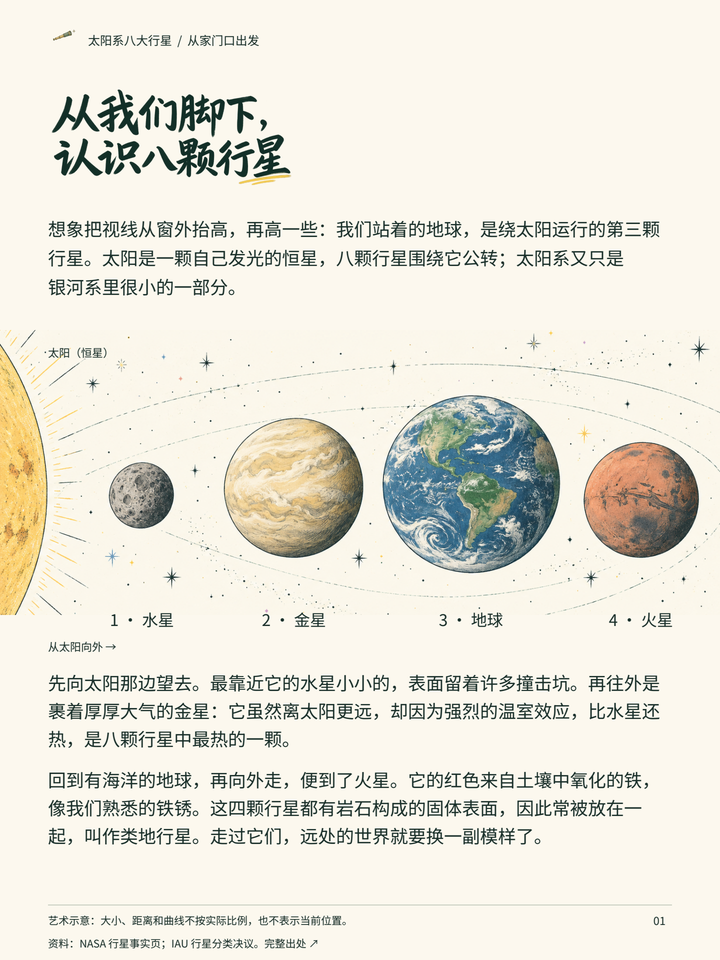
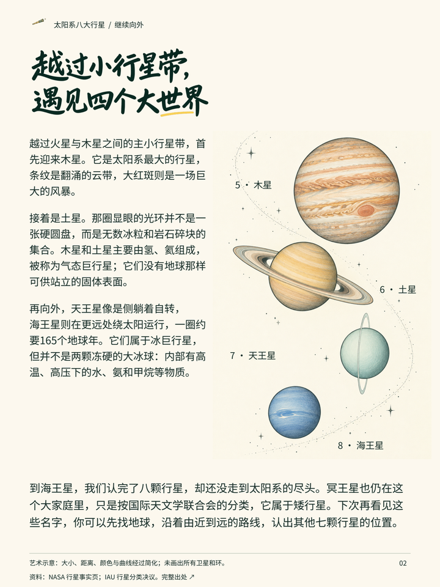

# 公开两页案例：太阳系八大行星

读者没有天文学背景。先用 NASA 与 IAU 资料核对八颗行星顺序、分类与边界，再从地球的位置组织一次向外旅行。前页横向认识四颗类地行星，后页纵向走近四颗巨行星，结尾补充冥王星属于矮行星。没有另加封面。

知识拆解依次回答：我们在哪里、为什么水星不最热、内侧四颗为何同组、外侧四颗怎样分、海王星是否是太阳系边界。成稿中这些问题融进自然段落，不逐一贴制作字段。

主插画由图像模型生成，中文正文与标签独立排版；标题为实际生成并校对的手写字图。图中大小与距离非比例，曲线不代表真实轨道或当前位置。

这是同一案例的轻量预览。完整正文、来源、提示和排版源在[公开仓库案例目录](https://github.com/NewenergyEric/eric-jiangzhishi-skill/tree/main/examples/solar-system)，使用 Skill 的方法本身不依赖联网获取这些文件。

一手来源：[NASA 行星](https://science.nasa.gov/solar-system/planets/)、[NASA 太阳系](https://science.nasa.gov/solar-system/solar-system-facts/)、[IAU 行星分类](https://www.iau.org/IAU/Iau/News/PR2006/iau-2006-general-assembly-resolution-votes.aspx)。没有把外部机构图片收入 Skill。未执行真实读者试读或各宿主自动发现测试。
